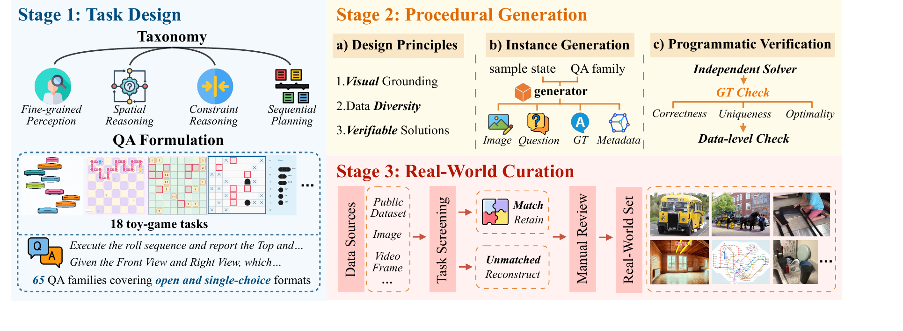
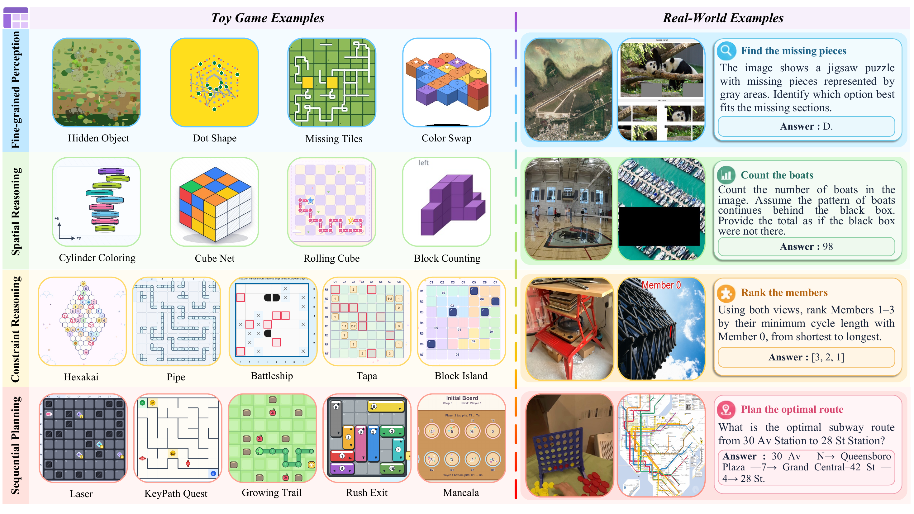
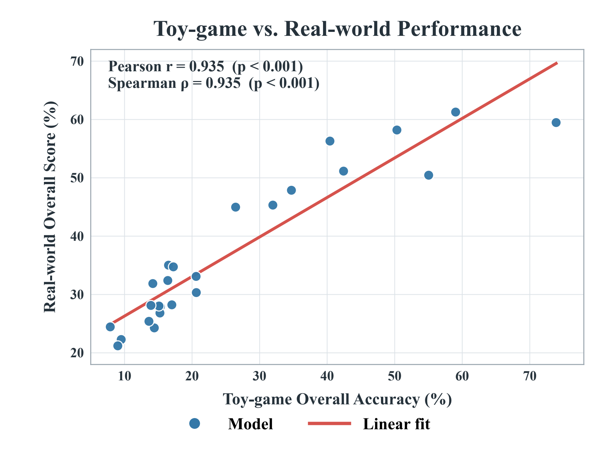
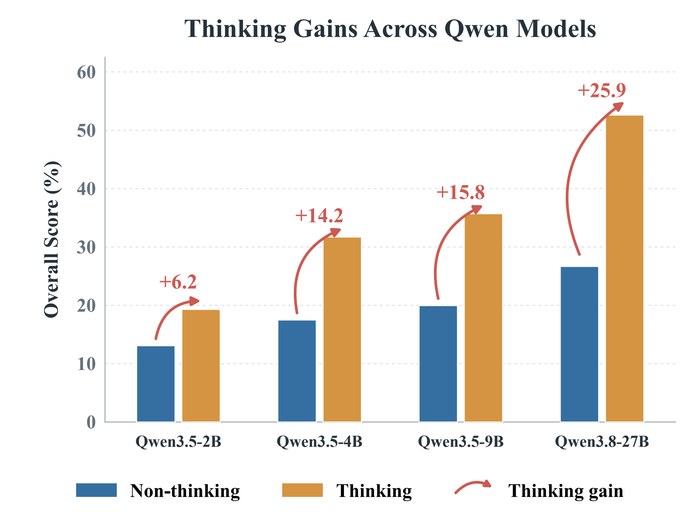
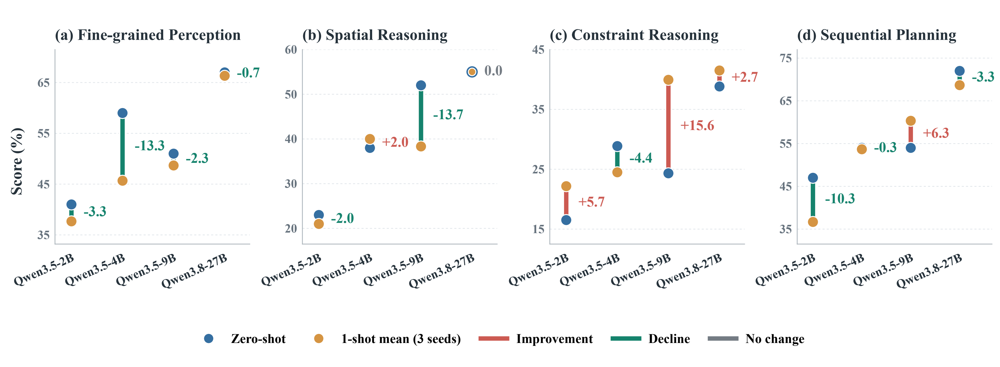

<div align="center">

# Game2Real-Bench

### Do Toy Games Reveal and Transfer to Real-World Visual Reasoning?

**A capability-aligned benchmark connecting controlled visual games with real-world visual reasoning.**

[](https://www.python.org/)
[](https://github.com/QingAnLiu/Game2Real-Bench/actions/workflows/ci.yml)
[](LICENSE)
[](https://huggingface.co/datasets/liuqa/Game2Real-Bench)
[](VLMEvalKit)

[Overview](#overview) · [Results](#results) · [Dataset](#dataset) · [Quick Start](#quick-start) · [VLMEvalKit](#vlmevalkit-evaluation) · [Contact](#contact) · [Citation](#citation)

</div>

## Overview

Game2Real-Bench asks a simple question: **do capabilities demonstrated in controlled visual games carry over to real-world visual reasoning?** Instead of matching scenes by appearance, it aligns the two settings through shared reasoning requirements: visual evidence, spatial operations, constraints, and state transitions.

The benchmark contains **1,400 evaluation samples** across four capabilities. The Toy Game partition provides controllable generation and programmatically verified answers; the Real World partition tests the same capability groups in natural images, videos, and multi-view observations.

<p align="center">
  
</p>

<p align="center"><em>Capability-guided task design, procedural generation and verification, and mechanism-aligned real-world curation.</em></p>

## Benchmark at a Glance

| Capability | Toy Game | Real World | Total |
|---|---:|---:|---:|
| Fine-grained Perception | 178 | 100 | 278 |
| Spatial Reasoning | 222 | 100 | 322 |
| Constraint Reasoning | 305 | 100 | 405 |
| Sequential Planning | 295 | 100 | 395 |
| **Total** | **1,000** | **400** | **1,400** |

- **18 toy-game tasks** and **65 QA families**.
- **400 single-choice** and **600 open-answer** Toy Game questions.
- **400 Real World questions**, balanced across the four capabilities.
- Deterministic, task-aware evaluation with no external judge model required.
- Single-image and ordered multi-image inputs.

<p align="center">
  
</p>

<p align="center"><em>Representative Toy Game and Real World tasks connected by shared reasoning requirements rather than visual similarity.</em></p>

## Results

We report **25 representative vision-language models** on the complete benchmark. Scores are percentages. Toy Game and Real World scores are computed independently over their respective partitions; Overall is the sample-weighted score over all 1,400 samples.

### Main Results

| Model | Toy Game | Real World | Overall |
|---|---:|---:|---:|
| **Proprietary models** |  |  |  |
| **GPT-5.6-Sol** | **73.90** | 59.48 | **69.8** |
| Gemini-3.1-Pro-Preview | 59.00 | **61.28** | 59.6 |
| Claude-Opus-4.8-thinking | 55.00 | 50.45 | 53.7 |
| **Large open-weight models (27-35B)** |  |  |  |
| **Qwen3.8-27B** | **50.30** | **58.20** | **52.6** |
| Qwen3.5-35B-A3B | 40.40 | 56.30 | 45.0 |
| Qwen3.5-27B | 42.40 | 51.15 | 44.9 |
| Gemma4-31B-it | 34.70 | 47.87 | 38.5 |
| Qwen3-VL-30B-A3B-Instruct | 16.50 | 35.03 | 21.8 |
| InternVL3.5-30B-A3B | 16.40 | 32.40 | 21.0 |
| **Medium open-weight models (7-12B)** |  |  |  |
| **Qwen3.5-9B** | **31.90** | **45.33** | **35.7** |
| Step3-VL-10B | 20.60 | 33.10 | 24.2 |
| Gemma4-12B-it | 20.60 | 30.33 | 23.4 |
| GLM-4.6V-Flash | 17.20 | 34.74 | 22.2 |
| Ovis2.5-9B | 17.00 | 28.23 | 20.2 |
| NEO-ov-9B | 15.30 | 27.93 | 18.9 |
| InternVL3.5-8B | 15.10 | 28.03 | 18.8 |
| SenseNova-U1-8B-MoT | 15.20 | 26.83 | 18.5 |
| Qwen3-VL-8B-Instruct | 13.90 | 28.13 | 18.0 |
| MiMo-VL-7B-RL | 14.40 | 24.28 | 17.2 |
| NEO-9B-SFT | 13.60 | 25.40 | 17.0 |
| **Small open-weight models (2-4B)** |  |  |  |
| **Qwen3.5-4B** | **26.40** | **44.98** | **31.7** |
| Qwen3.5-2B | 14.10 | 31.88 | 19.3 |
| NEO-2B-SFT | 9.50 | 22.28 | 13.2 |
| Qwen3-VL-2B-Instruct | 7.90 | 24.45 | 12.6 |
| InternVL3.5-2B | 9.00 | 21.20 | 12.5 |

Capability-level Toy Game / Real World scores are available in [`results/main_results.csv`](results/main_results.csv). The best result within each model group is bolded above.

### Game-to-Real Correspondence

Model-level Toy Game and Real World performance is strongly correlated across all 25 models: **Pearson r = 0.935** and **Spearman rho = 0.935** (both p < 0.001). Models that perform better in controlled games generally retain their advantage on real-world tasks, even though the visual domains differ substantially.

<p align="center">
  
</p>

### Thinking Mode

Thinking mode improves performance for all four evaluated Qwen models, with larger gains at greater model scale.

| Model | Thinking Off | Thinking On | Gain |
|---|---:|---:|---:|
| Qwen3.5-2B | 13.07 | 19.30 | +6.23 |
| Qwen3.5-4B | 17.48 | 31.70 | +14.22 |
| Qwen3.5-9B | 19.95 | 35.70 | +15.75 |
| Qwen3.8-27B | 26.66 | 52.60 | +25.94 |

<p align="center">
  
</p>

### Game-to-Real Transfer

We also test one-shot in-context learning by pairing each Real World target with a solved Toy Game example. Results are averaged over three demonstration assignments. Transfer is selective: constraint reasoning improves for three of four models, while fine-grained perception generally declines. Qwen3.5-9B is the only model with a positive overall mean gain.

| Model | Zero-shot | 1-shot Mean | Change |
|---|---:|---:|---:|
| Qwen3.5-2B | 31.88 | 29.38 | -2.50 |
| Qwen3.5-4B | 44.97 | 40.96 | -4.01 |
| Qwen3.5-9B | 45.33 | 46.82 | **+1.49** |
| Qwen3.8-27B | 58.21 | 57.88 | -0.33 |

<p align="center">
  
</p>

## Dataset

The data are hosted separately on Hugging Face:

```python
from datasets import load_dataset

dataset = load_dataset("liuqa/Game2Real-Bench")
toy_game = dataset["toy_game"]
real_world = dataset["real_world"]
```

The repository contains two TSV tables:

- `data/toy_game.tsv`: 1,000 Toy Game samples.
- `data/real_world.tsv`: 400 Real World samples.

Important fields include `id`, `question`, optional answer choices `A`-`F`, `answer`, `category`, `subfield`, `question_type`, `image_path`, and evaluator metadata. `image_path` is a JSON-encoded ordered list of repository-relative paths; preserve that order when constructing multimodal inputs.

Dataset files contain source material under mixed upstream terms. Review `LICENSE_DATA.md`, `ATTRIBUTION.md`, and `manifests/sources.tsv` in the dataset repository before reuse or redistribution.

## Quick Start

### 1. Install the bundled VLMEvalKit

```bash
git clone https://github.com/QingAnLiu/Game2Real-Bench.git
cd Game2Real-Bench
python -m pip install -e ./VLMEvalKit
```

### 2. Download the dataset

The dataset is currently a private preview. Authenticate with a Hugging Face account that has access:

```bash
hf auth login
hf download liuqa/Game2Real-Bench \
  --repo-type dataset \
  --local-dir ./Game2Real-Bench-data
```

### 3. Prepare and evaluate

Convert the downloaded tables to VLMEvalKit's local data layout. The utility resolves image paths without changing question text, answers, or image order:

```bash
python VLMEvalKit/utils/prepare_game2real_data.py \
  --dataset-root ./Game2Real-Bench-data \
  --partition all
```

Run inference with the registered dataset names:

```bash
python VLMEvalKit/run.py \
  --data Game2Real_ToyGame Game2Real_RealWorld \
  --model <VLMEvalKit_MODEL_NAME>
```

Inference and official scoring both run through VLMEvalKit; there is no separate Game2Real evaluation command. VLMEvalKit writes per-sample evaluation records and an `_acc.csv` capability summary next to each model output.

| Dataset name | Samples | Evaluation |
|---|---:|---|
| `Game2Real_ToyGame` | 1,000 | Game2Real deterministic Toy Game scorer |
| `Game2Real_RealWorld` | 400 | Seven task-aware Real World evaluator families |

No API credential is stored in `VLMEvalKit/vlmeval/config.py`. Configure provider credentials through environment variables only when the selected inference model requires them; Game2Real scoring itself is fully local.

## Evaluation Protocol

Toy Game evaluation first isolates the model's final committed answer from common reasoning and answer wrappers. Single-choice responses are reduced to one option letter; open responses are compared with the canonical answer and released structured `accepted_answers`. An incomplete reasoning trace without a final commitment receives no credit.

Real World samples use seven evaluator families: single-choice, short-text, numeric, ordered JSON, unordered JSON sets, ranking, and route planning. SpatiaLQA samples use semantic graph matching and report the mean of content F1 and precondition F1. Reviewed semantic decisions are shipped as a versioned local resource, so evaluation does not depend on model names or an external judge.

For comparable results:

- Preserve the image order in `image_path`.
- Do not rewrite questions or options.
- Record the evaluated partition, sample count, and dataset revision.
- Use the released deterministic scorer rather than manual or model-judge scoring.

## Repository Structure

```text
.
├── assets/figures/              # figures used in this README
├── results/main_results.csv     # capability-level results for 25 models
├── tests/                       # evaluator and release-integrity tests
└── VLMEvalKit/                  # bundled evaluation toolkit
    ├── run.py
    ├── utils/prepare_game2real_data.py
    └── vlmeval/dataset/
        ├── game2real_bench.py   # public dataset registrations
        └── utils/game2real/     # official deterministic evaluators
```

Procedural generators and task-specific verifiers are maintained as a separate release candidate while their public scope is being finalized.

## Testing

```bash
python -m pip install pytest numpy pandas openpyxl
python -m pytest -q
```

The tests cover final-answer extraction, accepted-answer structures, all Real World evaluator families, SpatiaLQA graph scoring, registration, and credential hygiene.

## License

Project-authored software is released under the [MIT License](LICENSE). Dataset images and annotations are distributed separately under mixed upstream terms; the software license does not relicense them. See [Third-Party Licenses](THIRD_PARTY_LICENSES.md) for software-side notices.

## Contact

- Qingan Liu: <2223884741@mail.dlut.edu.cn>
- Juntong Feng: <2253762636@mail.dlut.edu.cn>

## Citation

The manuscript is being prepared for public release. If you use this preview, please cite:

> Qingan Liu, Juntong Feng, Yue Zhu, Yujie Cheng, Xinzhe Han, Shuai Hao, Yunzhi Zhuge, Haiwen Diao, and Huchuan Lu. *Game2Real-Bench: Do Toy Games Reveal and Transfer to Real-World Visual Reasoning?* 2026.

```bibtex
@misc{liu2026game2realbench,
  title   = {Game2Real-Bench: Do Toy Games Reveal and Transfer to Real-World Visual Reasoning?},
  author  = {Liu, Qingan and Feng, Juntong and Zhu, Yue and Cheng, Yujie and Han, Xinzhe and Hao, Shuai and Zhuge, Yunzhi and Diao, Haiwen and Lu, Huchuan},
  year    = {2026}
}
```

Repository citation metadata are also provided in [`CITATION.cff`](CITATION.cff).

## Acknowledgements

Game2Real-Bench builds on the open-source multimodal evaluation ecosystem. We thank the maintainers of [VLMEvalKit](https://github.com/open-compass/VLMEvalKit) and the upstream datasets documented in the companion dataset repository.
